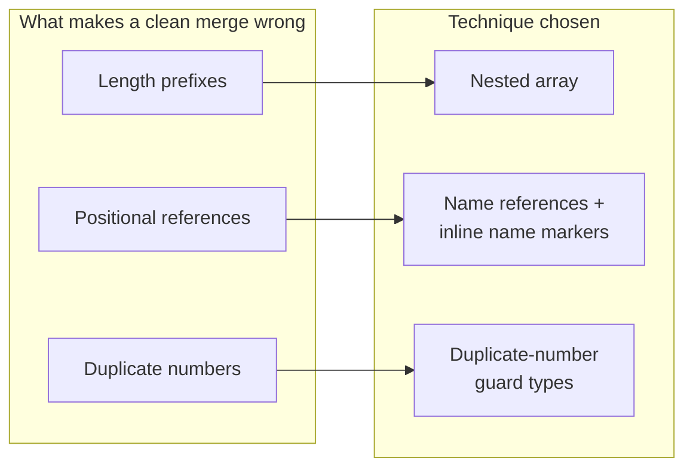

# ADR 0001: Merge-safe representation of embedded descriptors

- Status: Accepted
- Date: 2026-10-25
- Implemented in: [#14](https://github.com/izumin5210/protoc-gen-es-string-descriptor/pull/14)
- Evidence: [#12](https://github.com/izumin5210/protoc-gen-es-string-descriptor/pull/12)

## Summary

- **Question:** protoc-gen-es embeds a *descriptor* in every generated file: the `.proto` file's definitions, serialized as protobuf binary. How should generated code represent the descriptor and the references into it, so that merging generated code with git is safe?
- **Goals:**
  1. **Minimal conflicts.** If the `.proto` files merge cleanly, the generated code should too.
  2. **No silent failures.** A merge of generated code that differs from regenerating the merged `.proto` must either conflict or fail type checking.
- **Decision:** four techniques together:
  - a **nested array** without length prefixes;
  - **name references** instead of positions;
  - **inline name markers** placed next to the element they describe;
  - **duplicate-number guard types**.

  Each one is defined below.

## Context

A merge of generated code is correct only if it equals what regenerating the merged `.proto` produces. A merge is *silently wrong* when git merges cleanly, nothing reports an error, and the result still differs from regeneration.

Once the descriptor is made diff-friendly, git merges more changes, and three properties of today's representation cause silently wrong merges:



- **Length prefixes.** In protobuf binary, every nested element starts with the byte length of its content. If both sides grow one message by the same number of bytes, git sees the same length change on both sides and merges it. Part of the content then falls outside the message, and a field disappears.
- **Positional references.** Some references say *which one* by position:
  - in generated code, `messageDesc(file, 2)` means "the third message of the file";
  - in the descriptor, `oneof_index` says which oneof a field belongs to, and `public_dependency` says which import is public.

  If one side inserts an element and the other side adds a reference, the merge is clean, but the new reference points at the wrong element.
- **Duplicate numbers.** If both sides add a field with number 3, the merged `.proto` is invalid. With base64 the generated code always conflicts, so nobody misses this. In a merge-friendly representation the generated code merges cleanly and loads.

## Options

Each option is a representation of the descriptor and of the references into it.

| # | Representation | Conflicts (replay / matrix) | Silently wrong (replay / matrix) | Why not chosen |
| --- | --- | --- | --- | --- |
| 1 | One base64 line (protoc-gen-es) | 55 / 8,272 | 0 / 0 | Every concurrent edit conflicts |
| 2 | Raw bytes split into lines (protoc-gen-go style) | 25 / 2,333 | 2 / 67 | Length prefixes and positions both remain |
| 3 | Nested array, positional references kept | 2 / 416 | 5 / 196 | Positions shift silently |
| 4 | Nested array + **index manifest** | 8 / 536 | 0 / 0 | Safe, but two additions to the same list always conflict, e.g. two branches each adding a message |
| 5 | Nested array + name references, names in a **per-file name table** | 1 / 88 | 0 / 0 | Unrelated entries become neighbours in the table and conflict |
| **6** | **Nested array + name references + inline name markers** | **1 / 80** | **0 / 0** | **Chosen** |

- Options 4–6 include the duplicate-number guard types. Without them, duplicate numbers merge silently: in option 6, 2 of the 19 scenarios would be silently wrong.
- In a second replay of 85 pairs from three other googleapis files, option 5 had 7 conflicts and option 6 had 3. Neither had a silently wrong merge.

<details>
<summary>How the numbers were measured</summary>

Each method merges the generated `_pb.ts` with `git merge-file` and compares the result with code regenerated from the merged `.proto`. All scripts are in #12.

- **Replay:** pairs of consecutive commits (C1, C2) on `google/cloud/aiplatform/v1/{prediction_service,content,tool}.proto`, 91 pairs in total. C2 is treated as if it had been developed in parallel from the same base as C1.
- **Matrix:** every pair of single insert or delete edits over every list that is referenced by position, plus fields, enum values and methods, with same-size and different-size additions. That gives 8,272 pairs whose `.proto` merges cleanly.
- **Scenarios:** 19 minimal concurrent edits, run as tests in #14. 14 of them leave a valid `.proto`; 5 make it invalid.

</details>

<details>
<summary>Index manifest (option 4)</summary>

The index manifest keeps positional references, and adds a numbered list of every element they can point at, written as comments:

```ts
// top-level messages:
// 0: message example.v1.User
// 1: message example.v1.Team
```

If both sides insert into the same list, they renumber overlapping lines, and git conflicts. This makes stale positions impossible to merge silently. It also conflicts on the most common concurrent change: two branches each adding a message to a file.

A **name → index table** in code (`messageDesc(file, _idx.Invoice)` with `const _idx = { Invoice: 2 }`) behaves the same way, because the table still holds positions.

</details>

<details>
<summary>Per-file name table (option 5)</summary>

The per-file name table replaces positions inside the descriptor with names, kept in one list per file:

```ts
fileDesc(tree, imports, [
  ["oneof", "Event.click", "kind"],
  ["public", file_dep_b],
]);
```

Correct, but additions to unrelated messages can land on adjacent lines of the list and conflict.

</details>

## Decision

Represent each embedded descriptor with these four techniques.

1. **Nested array.** The descriptor is written as nested JavaScript arrays without length prefixes. The runtime computes the lengths again.

   <details>
   <summary>Example</summary>

   A sub-message (message, field, method, …) is `[tag, [children]]`; any other field stays a raw byte string. Each length-delimited field gets its own line, so an edit only touches the lines of the element it changes.

   ```ts
   ["\"", [                 // a message
    "\n\x04User",           // its name
    ["\x12", [              // a field of it
     "\n\x02id",
     "\x18\x01 \x01(\t",    // number 1, label, type
    ]],
   ]],
   ```

   </details>

2. **Name references.** Generated code looks schemas up by name, not by position.

   <details>
   <summary>Example</summary>

   ```ts
   messageDesc(file, 2)              // before: the third message
   messageDesc(file, "Outer.Inner")  // after
   ```

   This also applies to `enumDesc`, `serviceDesc` and `extDesc`. Map entries, the nested types that protobuf creates for `map` fields, are not counted.

   </details>

3. **Inline name markers.** Positions inside the descriptor are replaced by names, each stored in the element it describes. Unrelated additions therefore never become neighbours.

   <details>
   <summary>Example</summary>

   - A member of a oneof carries the oneof's name instead of `oneof_index`.
   - The file carries the names of its public and weak imports instead of `public_dependency` / `weak_dependency`.
   - Both are stored as unknown fields with reserved numbers: 536870911 on a field, 536870910 and 536870909 on the file. `FieldDescriptorProto` and `FileDescriptorProto` declare no extension ranges, so these numbers never hold real data.

   ```ts
   ["\x12", [
    "\n\x05click",
    "\x18\x02 \x01(\t",
    "\xfa\xff\xff\xff\x0f\x04kind",   // member of oneof "kind"
   ]],
   ```

   *Synthetic oneofs* are the oneofs protoc creates for each proto3 `optional` field. They are left out and re-created on load, because they follow from the fields.

   </details>

4. **Duplicate-number guard types.** For each message and enum, generated code exports a type keyed by field (or value) number. A duplicate number becomes a TypeScript error. The types do nothing at runtime.

   <details>
   <summary>Example</summary>

   ```ts
   export type _numbers_example_v1_User = {
     1: "id";
     3: "bio";   // added on one side
     2: "name";
     3: "age";   // added on the other side
   };
   // error TS2300: Duplicate identifier '3'.
   ```

   This catches merges whose `.proto` is invalid because of a duplicate number. Duplicate names are already caught by the existing generated types and exports.

   </details>

How these map onto `fileDesc` and the runtime is described in the README. The runtime restores the original descriptor bytes and hydrates them with protobuf-es's own `fileDesc`.

## Consequences

**Positive**

- Edits to unrelated parts of a `.proto` file merge cleanly and correctly. In the replay, conflicts dropped from 55 to 1 out of 91.
- Every measured bad merge either conflicts or fails: a type error, or an error on load.
- The compressed size is smaller: −29% gzip for the 173 files of `google/cloud/aiplatform/v1`. The minified size grows by 5%.

**Negative**

- **One known conflict.** A map field and a nested message added to the same message on both sides conflict, because map entries are nested types in the descriptor.
- **Type checking is required.** The guard types only help if the generated code is type-checked. `skipLibCheck` skips them in `.d.ts` files.
- **Breaking change.** The generated code needs a runtime that understands names.
- **Slower loading.** Loading spends extra time rebuilding the bytes: 137 files took 123 ms to load cold, against 95 ms for base64.
- **CI should still regenerate and diff.** These guarantees rely on git treating adjacent changes as conflicts.
