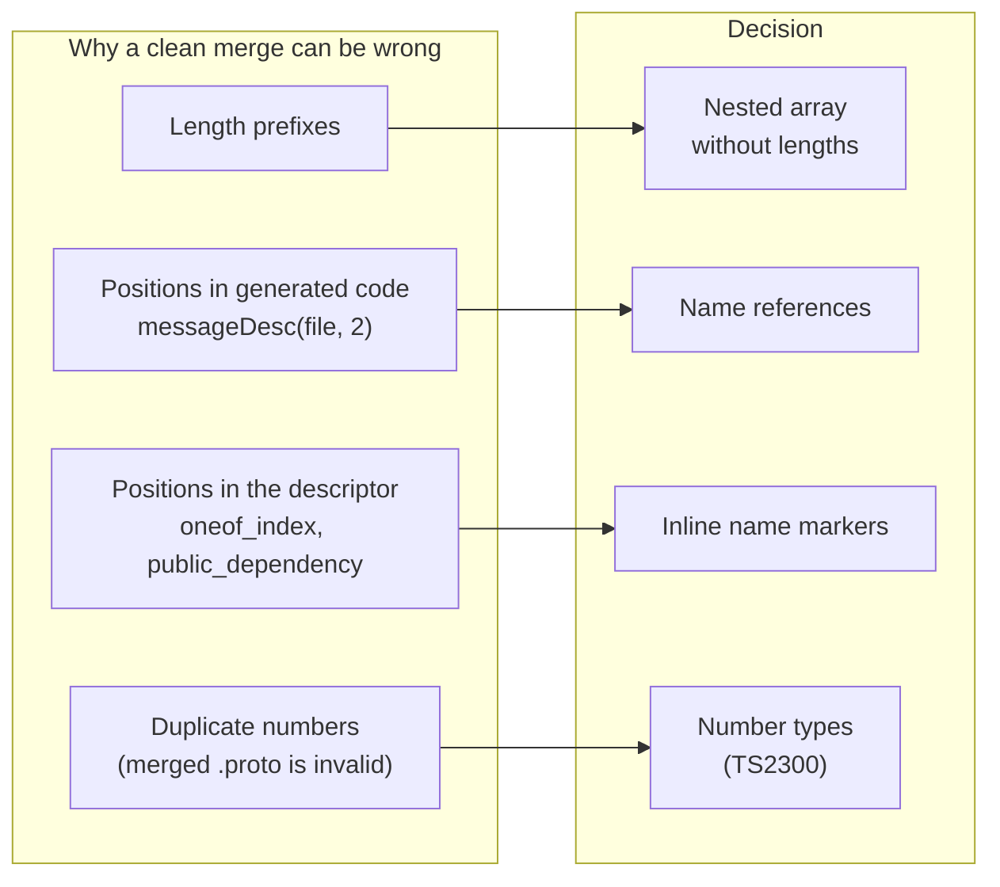

# ADR 0001: Merge-safe embedding of file descriptors

- Status: Accepted
- Date: 2026-10-24
- Implemented in: [#14](https://github.com/izumin5210/protoc-gen-es-string-descriptor/pull/14)
- Evidence: [#12](https://github.com/izumin5210/protoc-gen-es-string-descriptor/pull/12)

## Summary

- **Problem:** protoc-gen-es embeds each file descriptor as one base64 line, so concurrent edits to one `.proto` file always conflict in the generated code. Making that line diff-friendly is not enough. Once git merges more changes cleanly, some clean merges become *silently wrong*.
- **Decision:** embed the descriptor as a **length-less nested array**, replace every **positional reference** with a name, and emit **number types** so that duplicate numbers fail type checking. The runtime restores the descriptor and hands it to protobuf-es's own `fileDesc`.
- **Result:** in a replay of 91 commit pairs from googleapis, 90 merged correctly, 1 conflicted and 0 were silently wrong. base64 gave 36 correct and 55 conflicts.

## Context

A clean merge of generated code is only useful if it equals what regenerating the merged `.proto` would produce. Four properties of the descriptor and the generated code break that.

- **Length prefixes.** Every nested element carries the byte length of its content. Both sides growing one message by the same number of bytes changes the length identically, so git merges it, and part of the content falls outside the message.
- **Positions in generated code.** `messageDesc(file, 2)` and the other lookups use indices. If one side inserts a message and the other appends one, the merge is clean, but the appended schema points at another message.
- **Positions in the descriptor.** `oneof_index` (including synthetic oneofs of proto3 `optional`), `public_dependency` and `weak_dependency` shift the same way. The result is a field in the wrong oneof or the wrong public import.
- **Duplicates.** Both sides adding field number 3 makes the merged `.proto` invalid. The generated code still merges cleanly and loads silently.

## Decision

1. **Nested array without lengths.** A sub-message becomes `[tag, [children]]`; other fields stay raw byte strings, one length-delimited field per line. The runtime recomputes the lengths.
2. **Name references in generated code.** `messageDesc(file, "Outer.Inner")`, and likewise `enumDesc`, `serviceDesc` and `extDesc`. Map entries are not counted. The runtime still accepts numeric paths.
3. **Inline name markers in the descriptor.**
   - A real oneof member carries its oneof's name in unknown field 536870911.
   - The file carries public / weak import names in 536870910 / 536870909.
   - Synthetic oneofs are left out and re-created on load.
   - `FieldDescriptorProto` and `FileDescriptorProto` have no extension ranges, so these numbers never hold real data.
4. **Number types.** An exported `_numbers_<pkg>_<Msg>` type keyed by field number for each message, and likewise for each enum, in `.ts` and `.d.ts`. A duplicate number fails with `TS2300`.
5. **Hydrate through protobuf-es.**
   - While rebuilding the bytes from the array, the runtime resolves the markers and adds the synthetic oneofs in place.
   - It then base64-encodes the bytes and calls codegenv2's `fileDesc`. Behaviour after decoding is therefore protobuf-es's own.
   - `fileDesc(tree, imports)` keeps codegenv2's two arguments.

## Options considered

| Option | Silently wrong merges | Extra conflicts¹ | Runtime / API impact | Outcome |
| --- | --- | --- | --- | --- |
| base64 (protoc-gen-es) | none | every concurrent edit | — | Baseline |
| String literal split after `0x0a` (protoc-gen-go style, our 0.1) | yes: same-size edits, index shifts | fewer | none | Rejected |
| Nested array only | yes: index shifts | few | lengths rebuilt on load | Rejected |
| Nested array + numbered index manifest in comments | none | whenever both sides add a top-level message or enum | none | Rejected: conflicts on the most common concurrent change |
| Name → index table in generated code (`messageDesc(file, _idx.Invoice)`) | none | same as the manifest | none | Rejected: the table still holds positions |
| Names kept in a third `fileDesc` argument | none | unrelated additions become neighbours in the table | new argument | Rejected: more complex, and the extra conflicts |
| Duplicate checks at runtime | none | — | startup cost on every load | Rejected: number types catch the same at compile time |
| Re-implementing codegenv2's `fileDesc` | none | — | must follow protobuf-es changes | Rejected: compatibility not evident |
| **Nested array + inline name markers + number types** | none | one known case (below) | `fileDesc` accepts arrays; lookups accept names | **Chosen** |

¹ Conflicts for edits whose `.proto` merges cleanly and stays valid.

## Evidence

All numbers come from [#12](https://github.com/izumin5210/protoc-gen-es-string-descriptor/pull/12) and the tests in [#14](https://github.com/izumin5210/protoc-gen-es-string-descriptor/pull/14). The method is the same throughout: merge the generated `_pb.ts` with `git merge-file`, then compare the result with the code regenerated from the merged `.proto`.

**googleapis replay.** 91 pairs of consecutive commits on `google/cloud/aiplatform/v1/{prediction_service,content,tool}.proto`:

| Encoding | Correct | Conflict | Silently wrong |
| --- | --- | --- | --- |
| base64 | 36 | 55 | 0 |
| String literal | 64 | 25 | 2 |
| Nested array | 84 | 2 | 5 |
| Nested array + index manifest | 83 | 8 | 0 |
| **Chosen** | **90** | **1** | **0** |

A `google/pubsub/v1/pubsub.proto` pair (`8a4cc94afcb9` / `64ecfebceee5`) conflicted when names lived in a separate table. It merges correctly with inline markers.

**Scenarios.** There are 19 minimal concurrent edits, run as tests in #14:

- 14 whose merged `.proto` is valid: 13 merge correctly, including oneof members added to neighbouring messages; 1 conflicts (see Consequences).
- 5 whose merged `.proto` is invalid: all fail `tsc` or loading.

**Size.** For the 173 files of `google/cloud/aiplatform/v1`, after `esbuild --minify`: +5% minified and −29% gzip compared with base64. base64 hides repeated names from the compressor, which is why gzip shrinks.

## Consequences

**Positive**

- Concurrent edits to unrelated parts of a `.proto` file merge cleanly and correctly.
- Every measured clean merge is either correct or fails loudly (type error or load error).
- Smaller compressed bundles.

**Negative**

- **Breaking.** Code generated by this version needs this runtime. Code generated by 0.1 keeps working.
- **Type checking required.** Number types only help if generated code is type-checked. `skipLibCheck` skips them in `.d.ts`.
- **One known conflict.** A map field and a nested message added to the same message on both sides conflict, because map entries are nested types in the descriptor.
- **Costs.**
  - Name lookups build a per-file map on first use.
  - Type-check time and source size grow.
  - Loading rebuilds the bytes from the array, then protobuf-es decodes them. On a 105 KB descriptor with 300 messages, loading took 18.7–19.1 ms, against 14.7–14.9 ms for base64 (`pnpm bench`, min of 3 runs). The gap is rebuilding the bytes (about 2.3 ms) plus the base64 round trip into codegenv2 (about 1.3 ms). Hydrating all 137 files of a bundle cold took 123 ms, against 95 ms for base64 (#12).
- **CI should still regenerate and diff.** These guarantees rely on git's default merge treating adjacent changes as conflicts.
