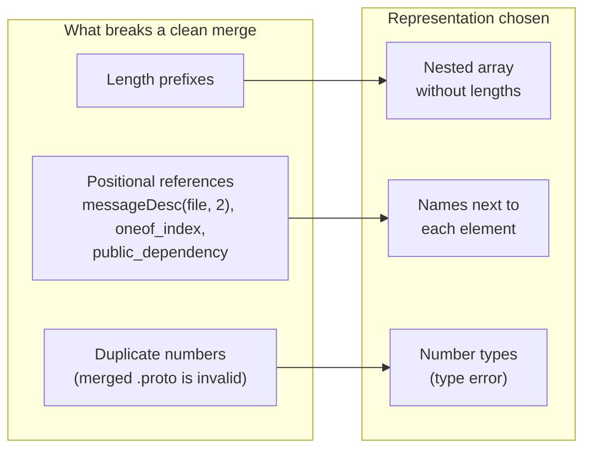

# ADR 0001: Merge-safe representation of embedded descriptors

- Status: Accepted
- Date: 2026-10-25
- Implemented in: [#14](https://github.com/izumin5210/protoc-gen-es-string-descriptor/pull/14)
- Evidence: [#12](https://github.com/izumin5210/protoc-gen-es-string-descriptor/pull/12)

## Summary

- **Question:** how should generated code represent the file descriptor and the references into it, so that git merges of generated code are safe?
- **Goals:**
  1. **Minimal conflicts.** If the `.proto` files merge cleanly, the generated code should too.
  2. **No silent failures.** A merged result that differs from regenerating the merged `.proto` must conflict or fail type checking. It must never load quietly.
- **Decision:** a **length-less nested array** with **name references instead of positions**, the names placed **next to the element they describe**, plus **number types** that turn duplicate numbers into type errors.

## Context

A merge of generated code is only correct if it equals what regenerating the merged `.proto` produces. Making the descriptor diff-friendly lets git merge more, and four things then go wrong without any error:

- **Length prefixes.** Every nested element carries the byte length of its content. If both sides grow one message by the same number of bytes, git sees identical length changes and merges them. Part of the content then falls outside the message.
- **Positional references.** Generated code looks schemas up by index (`messageDesc(file, 2)`), and the descriptor points at oneofs and imports by index. An insertion on one side shifts what the other side's new reference points at.
- **Duplicate numbers.** Two sides adding field number 3 make the merged `.proto` invalid, yet the generated code merges cleanly and loads.

## Options

Each option is a way of representing the descriptor and the references into it. Results come from merging the generated code with `git merge-file` and comparing it with regeneration (#12):

- *replay*: 91 commit pairs of `google/cloud/aiplatform/v1`;
- *matrix*: 8,272 single-edit pairs whose `.proto` merges cleanly.

| # | Representation | Conflicts (replay / matrix) | Silently wrong (replay / matrix) | Why not chosen |
| --- | --- | --- | --- | --- |
| 1 | One base64 line (protoc-gen-es) | 55 / 8,272 | 0 / 0 | Every concurrent edit conflicts |
| 2 | Raw bytes split into lines (protoc-gen-go style) | 25 / 2,333 | 2 / 67 | Length prefixes and positions both remain |
| 3 | Nested array without lengths, positions kept | 2 / 416 | 5 / 196 | Positions shift silently |
| 4 | Option 3 + positions made to conflict: a numbered list of every indexed element, as comments (or as a name → index table) | 8 / 536 | 0 / 0 | Safe, but any two additions to the same list conflict, e.g. two branches each adding a message |
| 5 | Option 3 + names instead of positions, names in one table per file | 1 / 88 | 0 / 0 | Unrelated entries end up adjacent in the table and conflict |
| **6** | **Option 3 + names next to each element** | **1 / 80** | **0 / 0** | **Chosen** |

Options 4–6 include the number types. Without them, duplicate numbers merge silently: in option 6 without number types, 2 of the 19 scenarios in #14 are silently wrong.

In a replay of 85 pairs from three other googleapis files, option 5 gave 7 conflicts and option 6 gave 3. Neither had a silently wrong merge.

## Decision

Represent each embedded descriptor as follows:

1. **Nested array without lengths.** A sub-message is `[tag, [children]]`, and any other field stays a raw byte string. Each length-delimited field has its own line, so an edit touches only the lines of the element it changes.
2. **Names instead of positions.**
   - Generated code looks elements up by name: `messageDesc(file, "Outer.Inner")`.
   - A real oneof member carries the name of its oneof.
   - The file carries the names of its public and weak imports.
   - Synthetic oneofs of proto3 `optional` fields are derivable, so they are left out.
3. **Names next to the element.** Each name sits in the element it describes, not in a shared list, so unrelated additions never become neighbours.
4. **Number types.** For each message and enum, a type is keyed by field or value number. A duplicate number is a TypeScript error.

How this maps onto `fileDesc` and the runtime is described in the README. The runtime restores the original descriptor bytes and hydrates them with protobuf-es's own `fileDesc`.

## Consequences

**Positive**

- Edits to unrelated parts of a `.proto` file merge cleanly and correctly. Conflicts in the replay drop from 55 to 1 out of 91.
- Every measured bad merge either conflicts or fails: a type error, or an error on load.
- Compressed size drops: −29% gzip for the 173 files of `google/cloud/aiplatform/v1`. Minified size grows by 5%.

**Negative**

- **One known conflict remains.** A map field and a nested message added to the same message conflict, because map entries are nested types in the descriptor.
- **Type checking is required.** The number types only help if the generated code is type-checked. `skipLibCheck` skips them in `.d.ts` files.
- **Breaking change.** The generated code needs a runtime that understands names.
- **Loading is slower.** Rebuilding the bytes adds to hydration: 123 ms against 95 ms for base64, for 137 files loaded cold.
- **CI should still regenerate and diff.** These guarantees rely on git treating adjacent changes as conflicts.
